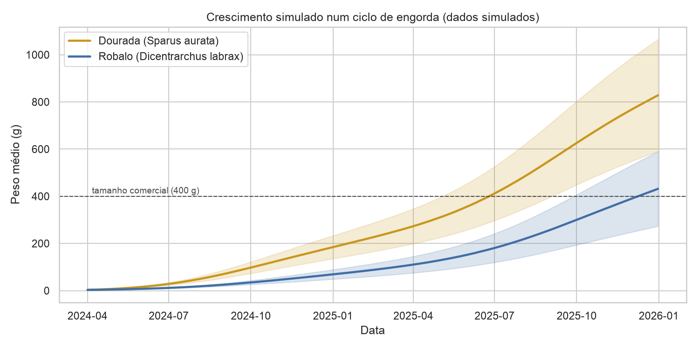
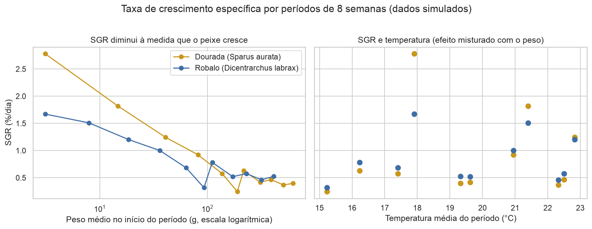
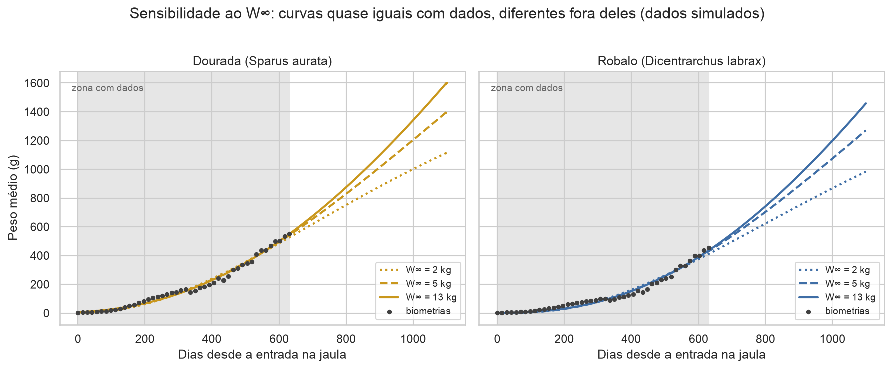
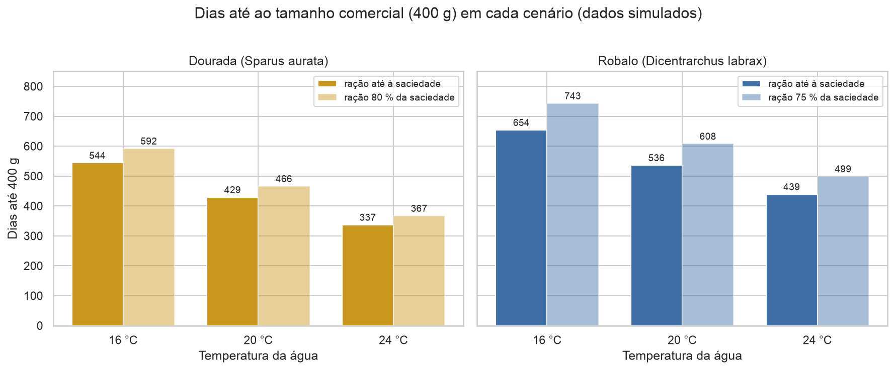
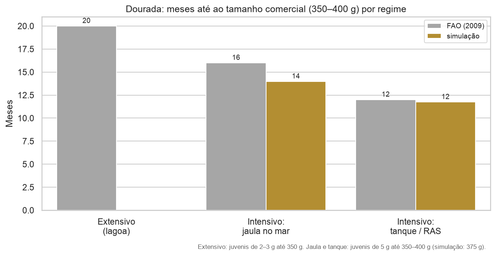

# Modelo de crescimento de dourada e robalo em aquacultura

Modelação do crescimento da **dourada** (*Sparus aurata*) e do **robalo** (*Dicentrarchus labrax*) em aquacultura, e simulação do efeito da **temperatura**, da **alimentação** e do **regime de cultivo** no tempo até ao tamanho comercial e na eficiência alimentar.

> ⚠️ **Os dados deste projeto são SIMULADOS.** Foram gerados a partir de parâmetros publicados na literatura científica (referências abaixo), com variação aleatória para se parecerem com dados reais. Não são registos de nenhuma exploração. O código está preparado para ser usado com dados reais (ver [Usar dados reais](#usar-dados-reais)).

## Objetivo

Responder a perguntas práticas de uma exploração de aquacultura:
- Quanto tempo demora cada espécie a chegar ao tamanho comercial (400 g)?
- Como variam a taxa de crescimento e o índice de conversão alimentar ao longo do ciclo?
- O que muda com a temperatura da água, com a quantidade de ração e com o regime de cultivo (jaula, tanque/RAS, IMTA, extensivo)?

## Contexto biológico

A dourada e o robalo são as duas principais espécies de peixe marinho produzidas no Mediterrâneo. São engordadas sobretudo em **jaulas no mar**, a partir de juvenis de 2–5 g, até cerca de 350–400 g, num ciclo de 14 a 18 meses (Cardia & Lovatelli, 2007). Como são animais ectotérmicos, o seu crescimento depende muito da **temperatura da água**: abranda no inverno e acelera no verão. A **ração** é o maior custo de produção, por isso a eficiência alimentar (FCR) é um indicador económico essencial.

## Dados

### Simulação

Cada peixe cresce, dia a dia, segundo a equação

$$\frac{dW}{dt} = a \cdot W^{\,b} \cdot e^{\,c \cdot T}$$

em que $W$ é o peso (g) e $T$ a temperatura (°C). Simulamos uma jaula de 5 000 peixes durante 640 dias, com:
- **variação individual** no ritmo de crescimento;
- **mortalidade** diária;
- **ração** calculada a partir do ganho de biomassa e do FCR;
- **biometrias** de 14 em 14 dias, numa amostra de 50 peixes (com erro de amostragem), no mesmo formato que teriam dados reais.

### Parâmetros e fontes

| Parâmetro | Dourada | Robalo | Fonte |
|---|---|---|---|
| Equação de crescimento: a, b, c | 0,024 · 0,514 · 0,060 | 0,010 · 0,68 · 0,05 | Hernández et al. (2003); Lanari et al. (2002) |
| Fator de calibração do crescimento | 1 | 1,14 | **Calibração** para a duração do ciclo de Cardia & Lovatelli (2007) |
| Sobrevivência no ciclo | 80 % | 85 % | Muniesa et al. (2020) |
| Duração de referência do ciclo | 14–16 meses | 16–18 meses | Cardia & Lovatelli (2007) |
| Peso dos juvenis à entrada | 3 g | 3 g | Cardia & Lovatelli (2007) |
| FCR | 2,1 | 2,2 | Kallitsis & Avramidis (2025) |
| Efeito da ração restrita | 80 % da saciedade | 75 % da saciedade | Bonaldo et al. (2010); Türkmen et al. (2012) |
| Regimes de cultivo | tabela da FAO | densidade em RAS; IMTA | FAO (2009); Sammouth et al. (2009); Cotou et al. (2024) |

**Pressupostos sem referência**, assinalados como tal no código:
- a variação individual do crescimento (coeficiente de variação de 15 %);
- a curva de temperatura do mar (15–23 °C);
- a temperatura dos tanques/RAS (22 °C, o meio do intervalo 18–26 °C da FAO).

Com a equação original, o robalo demorava cerca de 20 meses a chegar aos 400 g, acima dos 16–18 meses da literatura. Por isso multiplicámos o seu crescimento por 1,14. Este fator representa diferenças de regime de cultivo (densidade, ração, genética, tipo de instalação) entre o estudo original e os ciclos de referência, e **não é um valor publicado**.

## Métodos

| Notebook | Conteúdo |
|---|---|
| [01_simulacao_dados](notebooks/01_simulacao_dados.ipynb) | Simulação de um ciclo de engorda e validação com a literatura |
| [02_indicadores](notebooks/02_indicadores.ipynb) | SGR, GPD, FCR e sobrevivência; efeito do erro de amostragem |
| [03_modelo_von_bertalanffy](notebooks/03_modelo_von_bertalanffy.ipynb) | Ajuste da curva de von Bertalanffy com `scipy.optimize.curve_fit`, intervalos de confiança, R², resíduos e análise de sensibilidade |
| [04_cenarios](notebooks/04_cenarios.ipynb) | Cenários de temperatura (16, 20, 24 °C) e de alimentação |
| [05_regimes_de_cultivo](notebooks/05_regimes_de_cultivo.ipynb) | Extensivo, semi-intensivo, jaulas, tanques/RAS e IMTA |

As funções estão em [`src/`](src/):

| Ficheiro | Conteúdo |
|---|---|
| `growth.py` | Modelo de crescimento e simulação |
| `indicators.py` | Indicadores de produção |
| `von_bertalanffy.py` | Curva de von Bertalanffy e ajuste |
| `regimes.py` | Valores da literatura para os regimes de cultivo |
| `dados.py` | Leitura de CSV |

### Indicadores

| Indicador | Fórmula |
|---|---|
| Taxa de crescimento específica (%/dia) | $SGR = 100 \times (\ln W_f - \ln W_i) / t$ |
| Ganho de peso diário (g/dia) | $GPD = (W_f - W_i) / t$ |
| Índice de conversão alimentar | $FCR = \text{ração (kg)} / \text{ganho de biomassa (kg)}$ |
| Sobrevivência (%) | $100 \times N_f / N_i$ |

## Principais resultados

### 1. Crescimento simulado



A dourada chega aos 400 g em cerca de **15 meses** e o robalo em cerca de **18 meses**, de acordo com a literatura. O crescimento abranda no inverno e acelera no verão.

### 2. Indicadores de produção



- A **SGR desce à medida que o peixe cresce**, de 2–3 %/dia nos juvenis para menos de 0,5 %/dia nos peixes comerciais, e cai no inverno.
- O **FCR económico (≈ 2,3)** é mais alto do que o biológico, porque inclui a ração comida pelos peixes que morreram.
- Indicadores calculados entre **biometrias muito próximas** (14 dias) não são fiáveis por causa do erro de amostragem; períodos de 8 semanas dão valores estáveis.

### 3. Curva de von Bertalanffy



A curva ajusta-se bem (R² > 0,98), mas **o peso assintótico W∞ não é identificável**: os dados de engorda só cobrem o início do crescimento. Com W∞ fixo em 2, 5 ou 13 kg, as curvas são quase iguais na zona com dados, o coeficiente k muda cerca de 3 vezes e as previsões fora dos dados divergem. Por isso, **k só pode ser comparado entre estudos que usem o mesmo W∞**.

### 4. Cenários de temperatura e alimentação



| Ração até à saciedade | Dourada | Robalo |
|---|---|---|
| Dias até 400 g a 16 / 20 / 24 °C | 544 / 429 / 337 | 654 / 536 / 439 |

- Entre 16 e 24 °C o ciclo encurta **cerca de 7 meses** nas duas espécies.
- A **dourada chega aos 400 g cerca de 3,5 meses antes** do robalo.
- A **ração restrita** tem efeitos diferentes nas duas espécies:
  - na dourada, atrasa o ciclo 1–1,5 meses, mas baixa o FCR económico de 2,3 para 1,9;
  - no robalo, só atrasa o ciclo.

### 5. Regimes de cultivo



- **Tanque/RAS:** com temperatura controlada, o ciclo é cerca de **2 meses mais curto** do que em jaula no mar. O tempo simulado (≈ 12 meses) coincide com a FAO (2009).
- **Densidade em RAS:** o robalo mantém o crescimento até **70 kg/m³** e cresce 14 % mais devagar a 100 kg/m³ (Sammouth et al., 2009).
- **IMTA:** reduz a ração do robalo em cerca de **11 %**, sem alterar o crescimento (Cotou et al., 2024).
- **Extensivo e semi-intensivo:** não foram simulados, porque os peixes se alimentam de alimento natural e o modelo assume ração.

### Limitações

- Os dados são simulados.
- O modelo não tem temperatura ótima, por isso só é válido até 25 °C.
- A mortalidade é constante.
- Os efeitos da alimentação, da densidade e do IMTA vêm de ensaios curtos e foram extrapolados para um ciclo inteiro.

## Como correr o projeto

Testado com Python 3.14.

```bash
git clone https://github.com/dinistcosta/aquaculture-growth-model.git
cd aquaculture-growth-model
python3 -m venv venv
source venv/bin/activate          # no Windows: venv\Scripts\activate
pip install -r requirements.txt
```

Depois abrir os notebooks da pasta `notebooks/` por ordem, no VS Code ou no Jupyter (`pip install notebook` e `jupyter notebook`). O notebook 01 gera o ficheiro `data/raw/registos_simulados.csv`, usado pelos seguintes.

### Usar dados reais

Basta um CSV com uma linha por biometria e as colunas:

```
dia, peso_medio_g, temperatura_c, racao_kg, n_peixes
```

`racao_kg` é a ração dada desde a biometria anterior; `especie` e `data` são opcionais. Nos notebooks 02 e 03, substituir o caminho em `ler_registos("../data/raw/registos_simulados.csv")` pelo do novo ficheiro.

## Estrutura

```
aquaculture-growth-model/
├── data/
│   ├── raw/            registos de biometria (simulados)
│   └── processed/
├── notebooks/          análises 01 a 05
├── src/                funções reutilizáveis
├── figures/            gráficos exportados
├── requirements.txt
└── README.md
```

## Ferramentas

Python · NumPy · pandas · Matplotlib · seaborn · SciPy · Jupyter

## Referências

- Bonaldo, A., Isani, G., Fontanillas, R., Parma, L., Grilli, E. & Gatta, P.P. (2010). Growth and feed utilization of gilthead sea bream (*Sparus aurata*, L.) fed to satiation and restrictively at increasing dietary energy levels. *Aquaculture International* 18: 909–919. https://doi.org/10.1007/s10499-009-9312-0
- Cardia, F. & Lovatelli, A. (2007). A review of cage aquaculture: Mediterranean Sea. *FAO Fisheries Technical Paper* 498: 156–187.
- Cotou, E., Miliou, H., Chatzoglou, E., Schoina, E., Politakis, N., Kogiannou, D., Fountoulaki, E., Androni, A., Konstantinopoulou, A., Assimakopoulou, G. & Nathanailides, C. (2024). Growth performance and environmental quality indices and biomarkers in a co-culture of the European sea bass with filter and deposit feeders: a case study of an IMTA system. *Fishes* 9: 69. https://doi.org/10.3390/fishes9020069
- El-Desoki, M.O., Younis, Y.M., Youssef, E.D.A., Ahmed, S.M., Ahmed, K.S. & Al-Beak, A.M. (2021). Age, growth and mortality of the European seabass (*Dicentrarchus labrax*) in Bardawil lagoon, North Sinai, Egypt. *International Journal of Aquaculture and Fishery Sciences* 7(4): 42–46. https://doi.org/10.17352/2455-8400.000072
- FAO (2009). *Sparus aurata*. In: Cultured aquatic species fact sheets. Texto de Colloca, F. & Cerasi, S.; editado por Crespi, V. & New, M.
- Hernández, J.M., Gasca-Leyva, E., León, C.J. & Vergara, J.M. (2003). A growth model for gilthead seabream (*Sparus aurata*). *Ecological Modelling* 165: 265–283. https://doi.org/10.1016/S0304-3800(03)00095-4
- Kallitsis, E. & Avramidis, P. (2025). Life cycle assessment of aquaculture production in Greece. *Cleaner Environmental Systems* 16: 100261. https://doi.org/10.1016/j.cesys.2025.100261
- Kallitsis, E., Korre, A., Mousamas, D. & Avramidis, P. (2020). *Sustainability* 12: 9617.
- Kraljević, M., Dulčić, J. & Tudor, M. (1998). Growth parameters of the gilt-head sea bream *Sparus aurata* L. in the eastern Adriatic (Croatian waters). *Periodicum Biologorum* 100: 87–91.
- Lanari, D., D'Agaro, E. & Ballestrazzi, R. (2002). Growth parameters in European sea bass (*Dicentrarchus labrax* L.): effects of live weight and water temperature. *Italian Journal of Animal Science* 1: 181–185. https://doi.org/10.4081/ijas.2002.181
- Muniesa, A. et al. (2020). Mapping the knowledge of the main diseases affecting sea bass and sea bream in Mediterranean. *Transboundary and Emerging Diseases* 67: 1089–1100. https://doi.org/10.1111/tbed.13482
- Person-Le Ruyet, J. et al. (2004). *Aquaculture* 237: 269–280.
- Sammouth, S., Roque d'Orbcastel, E., Gasset, E., Lemarié, G., Breuil, G., Marino, G., Coeurdacier, J.-L., Fivelstad, S. & Blancheton, J.-P. (2009). The effect of density on sea bass (*Dicentrarchus labrax*) performance in a tank-based recirculating system. *Aquacultural Engineering* 40: 72–78. https://doi.org/10.1016/j.aquaeng.2008.11.004
- Somers, I.F. (1988). On a seasonally oscillating growth function. *Fishbyte* 6(1): 8–11.
- Türkmen, S., Eroldoğan, O.T., Yılmaz, H.A., Ölçülü, A., İnan, G.A.K., Erçen, Z. & Tekelioğlu, N. (2012). Compensatory growth response of European sea bass (*Dicentrarchus labrax* L.) under cycled starvation and restricted feeding rate. *Aquaculture Research* 43: 1643–1650. https://doi.org/10.1111/j.1365-2109.2011.02970.x

## Agradecimentos

Parte do código e da documentação deste projeto foi desenvolvida com a ajuda do **Claude** (Anthropic), um assistente de inteligência artificial.

## Autor

Dinis Costa · Mestrado em Biologia Marinha Aplicada
